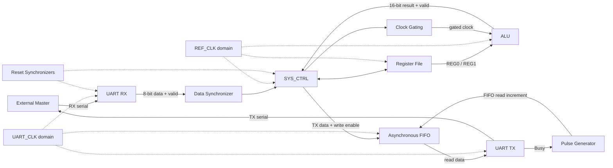

# System Architecture

## Top-level organization

The system is organized around two clock domains and the clock-domain crossing (CDC) structures between them.

### Reference-clock domain (`REF_CLK`)

- System controller (`SYS_CTRL`)
- Register file
- ALU
- ALU clock-gating block
- Asynchronous FIFO write side
- UART RX data synchronization into the reference-clock domain

### UART-clock domain (`UART_CLK`)

- UART receiver and transmitter, each driven by its generated clock
- Clock dividers
- Pulse generation for the FIFO read request
- Asynchronous FIFO read side

### Clock-domain crossing

- Reset synchronizers for the reference and UART domains
- Data synchronizer for the received UART parallel data bus
- Asynchronous FIFO with independent write/read clocks and synchronized pointers

## Data flow

1. A serial command enters the UART RX block.
2. UART RX produces an 8-bit parallel data word and a valid indication.
3. The data synchronizer transfers the received word and its enable pulse into the `REF_CLK` domain.
4. `SYS_CTRL` decodes the command and coordinates register-file accesses or ALU operations.
5. For results sent back to the external master, `SYS_CTRL` writes response data to the asynchronous FIFO.
6. The UART TX side reads the FIFO in the UART clock domain and serializes the outgoing data.

## Block-level view

The diagram is a functional overview, not a pin-accurate netlist. The RTL and the detailed interfaces remain the authoritative implementation.

## Clock and reset

The project specification lists:

| Signal | Specified frequency |
|---|---:|
| `REF_CLK` | 50 MHz |
| `UART_CLK` | 3.6864 MHz |

The specification also states that the clock-divider enable is held high. The divider ratio is programmable through register `REG3`, and UART prescale is configured through `REG2`.

## Register map (documented intent)

| Address | Register | Purpose |
|---|---|---|
| `0x0` | `REG0` | ALU operand A |
| `0x1` | `REG1` | ALU operand B |
| `0x2` | `REG2` | UART parity and prescale configuration |
| `0x3` | `REG3` | Clock division ratio |

`REG2[0]` is parity enable (documented default 1), `REG2[1]` is parity type (default 0), and `REG2[7:2]` is the prescale field (documented default 32). `REG3[7:0]` holds the division ratio (documented default 32).

## UART command protocol

The project specification defines the following command frame sequences:

| Command | Opcode | Frames | Sequence |
|---|---:|---:|---|
| Register-file write | `0xAA` | 3 | command, address, write data |
| Register-file read | `0xBB` | 2 | command, address |
| ALU operation with operands | `0xCC` | 4 | command, operand A, operand B, ALU function |
| ALU operation without operands | `0xDD` | 2 | command, ALU function |

## ALU operations

The RTL implements the following function encodings:

| `ALU_FUN` | Operation |
|---:|---|
| `0000` | Addition |
| `0001` | Subtraction |
| `0010` | Multiplication |
| `0011` | Division |
| `0100` | AND |
| `0101` | OR |
| `0110` | NAND |
| `0111` | NOR |
| `1000` | XOR |
| `1001` | XNOR |
| `1010` | Equality comparison |
| `1011` | Greater-than comparison |
| `1100` | Less-than comparison |
| `1101` | Shift right by one |
| `1110` | Shift left by one |

With the default 8-bit operands, the RTL declares a 16-bit ALU result (`OUT_WIDTH = 2 * OPER_WIDTH`).
