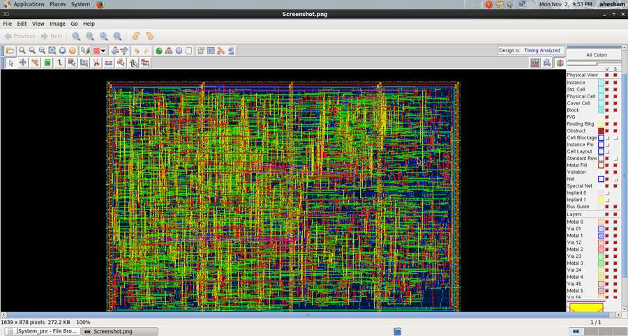

# Multi-Clock Digital System

A modular multi-clock digital system implemented in Verilog/SystemVerilog. The design integrates UART communication, an asynchronous FIFO, a system controller, a register file, an ALU, and clock/reset management.



## System architecture

The design is organized around two clock domains:

- **Reference-clock domain (`REF_CLK`):** system controller, register file, ALU, ALU clock gating, FIFO write side, and UART RX data synchronization.
- **UART-clock domain (`UART_CLK`):** UART RX/TX clock generation, UART interfaces, pulse generator, and FIFO read side.
- **CDC structures:** reset synchronizers, data synchronizer, and asynchronous FIFO with independently clocked read/write sides.

The supplied specification lists `REF_CLK = 50 MHz` and `UART_CLK = 3.6864 MHz`. See [System Architecture](Documentation/Architecture.md) for system data flow, register map, command framing, and ALU function encodings.

## Main RTL blocks

- **System control:** command decoding and sequencing for register-file and ALU operations.
- **UART RX/TX:** serial communication, sampling, serialization, parity checking, and framing checks.
- **Asynchronous FIFO:** buffering between the reference and UART clock domains.
- **Register file:** configurable data/address widths, with reserved registers used for ALU operands and UART/clock configuration.
- **ALU:** arithmetic, logic, comparison, and shift operations.
- **Clock/reset and CDC:** clock dividers, clock gating, reset synchronizers, data synchronizer, and FIFO pointer synchronizers.

## Repository structure

```text
.
├── RTL/
├── Verification/
├── Synthesis/
│   └── Reports/
├── DFT/
│   └── Reports/
├── Formality/
│   └── Reports/
├── Physical_Design/
│   └── Reports/
└── Documentation/
    ├── Architecture.md
    ├── Specification_Reconciliation.md
    └── images/
```

## Verification

The integrated testbench is included in `Verification/SYSTEM_TB.v`. Its stimulus covers UART command-based register-file access, ALU operations, and configuration updates. The source contains output comparisons. The current public snapshot does not claim a complete reproducible simulation transcript or a quantified coverage result.

## ASIC implementation results

The repository now documents the available results by implementation stage:

| Stage | Key result | Detailed report |
|---|---|---|
| Synthesis area | 2,042 mapped cells; total cell area 27,433.584466 library area units | [Synthesis reports](Synthesis/Reports/README.md) |
| Synthesis timing | Worst setup slack +17.95 ns; worst reported hold slack +0.42 ns | [Synthesis reports](Synthesis/Reports/README.md) |
| Synthesis power | Approximately 0.296 mW, low-effort estimate with incomplete activity annotation | [Synthesis reports](Synthesis/Reports/README.md) |
| Scan DFT | 385 valid scan cells / 386 sequential cells; 99.55% estimated fault coverage | [DFT report](DFT/Reports/README.md) |
| Formality | 386 passing compare points in post-synthesis and post-DFT runs | [Post-synthesis](Formality/Reports/Post_Synthesis_Equivalence.md) · [Post-DFT](Formality/Reports/Post_DFT_Equivalence.md) |
| Post-route setup | WNS +2.649 ns; TNS 0; zero reported violating paths | [Post-route timing](Physical_Design/Reports/Post_Route_Timing.md) |
| Post-route hold | WNS +0.039 ns; TNS 0; zero reported violating paths | [Post-route timing](Physical_Design/Reports/Post_Route_Timing.md) |
| Physical checks | Geometry check with `-noMinArea` reports zero findings; connectivity check reports no problems | [Geometry/connectivity](Physical_Design/Reports/Geometry_and_Connectivity.md) |
| Physical power | 0.7142 mW preliminary estimate; no activity file supplied | [Power estimate](Physical_Design/Reports/Power_Estimate.md) |

**Important qualifications:** the DFT report states zero internal ATPG patterns; the 99.55% figure is a tool estimate, not ATPG sign-off. Formality used Synopsys Auto Setup, and post-DFT comparison excluded four scan-output ports. The geometry command excluded minimum-area checks and is not full foundry DRC; the connectivity check is not LVS. Power figures are estimates under incomplete activity information.

## Top-cell naming note

The synthesis and Formality logs identify the design as `SYSTEM_TOP`, while the Encounter physical-design reports identify it as `SYS_TOP`. This distinction is retained in the reports because the supplied evidence does not independently establish the exact naming/mapping relationship.

## Tools and reproduction

The available artifacts indicate use of Synopsys Design Compiler, Synopsys Formality, scan DFT tooling, and Cadence Encounter. The original EDA scripts, complete constraints, licensed technology libraries, and some tool setup files are not included in this public snapshot. Reproducing the complete ASIC flow requires the corresponding licensed tools, technology files, and project constraints.

Proprietary PDK/library data, license material, extracted implementation databases, and environment-specific absolute paths are intentionally excluded.
